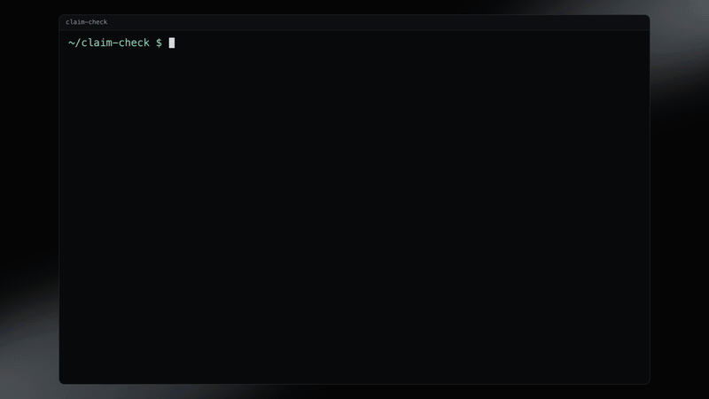
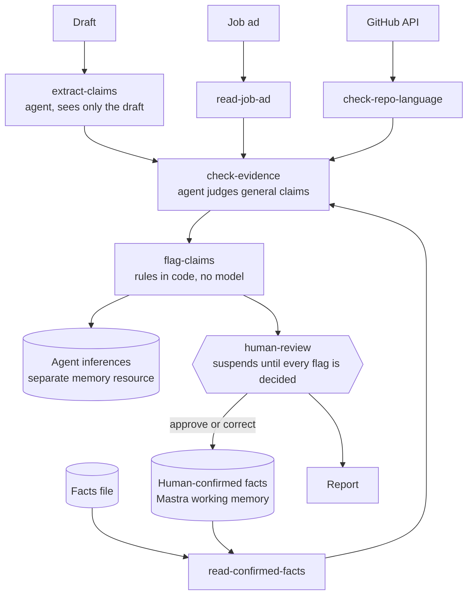

# claim-check

AI-written text can read well and still state things that never happened. Reading the result is a weak defence, because a false claim that sounds right is easy to miss.

claim-check takes a draft, pulls out every factual claim, checks each one against facts a person has confirmed, and stops for a human. The example here is a job application, checked against one candidate's facts. Nothing is marked verified until a person approves it. When a person corrects something, the correction is saved and used on the next run.

Built on [Mastra](https://mastra.ai) in TypeScript. The model is `openai/gpt-oss-120b` on Groq. The candidate and the companies in `data/` are invented, and the GitHub repos belong to GitHub's `octocat` demo account.

## Demo

[](docs/demo.mp4)

Click the animation for the full quality video.

One run end to end on the invented sample candidate. A claim is flagged, Mastra Studio shows the paused step pointing to the review page, a person decides every flagged claim there and corrects one, and the next run cites the correction. Then the trace, and the eval cases as a Mastra dataset. 52 seconds, no audio.

What is real and what is not. It was filmed on a fresh, empty database, which is why it runs on port 4112. The terminal output comes from real runs, and the Studio and review page screens are real screenshots of real clicks, typing and a real submit. The cursor, the typing animation and the terminal scrolling are drawn on top. The closing numbers are not from anything on screen: 33 of 33 and 19 of 19 come from the saved run on all 42 cases (`evals/results/all-final.json`), which is not a clean held-out number, and 39 of 50 is the FEVER run. See [Evals](#evals).

## Run it

Needs a Groq API key. Tested on Node 26.

```bash
npm install
cp .env.example .env   # then add your GROQ_API_KEY
```

```bash
npm run check -- data/drafts/cover-letter.md   # stops for review, prints a run id and a review page link
npm run review -- <run id>                     # decide each flagged claim, can be a new process
npm run facts                                  # what a human confirmed vs what the agent inferred
npm run check -- data/drafts/cover-letter.md   # same draft again, now using your corrections
npm run facts -- retract <fact id> --reviewer <name> --reason <why>   # take back a fact approved by mistake
npm test                                       # no network or API key needed
npm run evals -- --split heldout --rounds 3    # the real model and the real GitHub API
npm run dataset                                # load the 42 cases into a Mastra dataset, to browse in Studio
npm run fever -- --n 50                        # the evidence checker on a FEVER sample (see Evals)
npm run dev                                    # Mastra Studio at http://localhost:4111, review page at /review
```

## What happens to a claim

Real output from the sample draft, which says "I travelled to dental clinics across Sweden".

| Run | Result for that claim |
|---|---|
| First run | `no_evidence`. Nothing in the facts file covers travel, so it is flagged. |
| Human review | Corrected to "Worked with dental clinics by phone and video call, never on site." Saved as `H-3aa3e7`, source `human-correction`. |
| Second run, same draft | `contradicted`, citing `H-3aa3e7`. The run knows something it did not know before. |
| Fixed draft | 0 flagged, 5 supported, and still 0 verified until someone approves them. |

## Architecture



| Path | What it is |
|---|---|
| `src/mastra/workflows/claim-check.ts` | The four steps, with suspend and resume in `human-review` |
| `src/mastra/logic.ts` | Every rule that decides a status. No model and no I/O, so all of it is unit tested |
| `src/mastra/ledger.ts` | Persistent memory, with human facts and agent inferences kept apart |
| `src/mastra/tools/index.ts` | The three Zod-validated tools |
| `src/mastra/scorers.ts`, `evals/` | Mastra scorers, 42 labelled cases, the runner, and saved results |
| `src/mastra/page.ts`, `src/mastra/routes.ts` | The review page and its local-only API. It can start a check, lists waiting runs, shows every claim, and takes all decisions at once. It never writes a fact itself. It resumes the workflow, and the `human-review` step decides what gets written |
| `cli.ts` | `check`, `review`, `facts` and `facts retract` |

## Design decisions

**The model cannot write to confirmed facts.** This is the main idea in the project. An agent with working memory gets an `updateWorkingMemory` tool by default, and then a guess can be stored as something the person said. Here no agent has the memory attached. The only code that calls `addConfirmed` is the human review step, and it requires a reviewer's name.

**Human facts and agent inferences live under separate resource ids.** Every verdict the agent reaches is recorded, but as `<candidate>:agent-inferred`. `read-confirmed-facts` never reads that resource, so an inference cannot become evidence by accident. A test plants a marker in an inference and checks that it never reaches a later prompt.

**The workflow calls the tools, the model does not.** Reading the evidence is not optional, so it should not depend on a model choosing to do it. The tools are still registered, so they can be run by hand in Studio.

**The language check has no model in it.** It compares what the draft states with what the GitHub API returns. A model cannot talk its way out of it.

**The extractor never sees the facts.** If it did, what it believed to be true could change what it chose to extract, and false claims could quietly disappear at the first step.

**Failing closed.** "Supported" with a citation that does not exist becomes a flag. So does a missing verdict, an unknown repo, a GitHub rate limit, or a repo with no main language. The only way to avoid a flag is a verdict that cites real evidence.

**A partial review writes nothing.** Decisions accumulate in the suspended run's snapshot, and facts are written once every flagged claim has a decision.

## Failure modes it is built to catch

| Type | Invented example | How it is caught |
|---|---|---|
| Location or travel that never happened | "I travelled to dental clinics", when all the work was by call | Contradicted by a confirmed fact, or flagged as having no evidence |
| Invented origin story for assigned work | "Nobody asked me to", when it was a ticket from a team lead | Contradicted by a confirmed fact |
| Wrong language on a project | "I wrote linguist in Python", when GitHub says Ruby | GitHub API, no model involved |

## Failure modes of this system

These are the ways it can still go wrong.

- **A claim the extractor misses is never checked.** This is the worst one, because nobody sees a miss. As a partial defence, every sentence that produced no claim is shown to the reviewer. The sample draft's Oslo sentence was caught this way before the prompt was fixed. Extraction also varies between runs: the same draft gave 8 claims once and 9 another time.
- **The checker can cite a real fact that does not back the claim.** The code checks that the id exists, not that the fact supports the claim. This is why supported claims still need a human.
- **A person can approve something false.** An approved claim becomes evidence for later runs. `facts retract` stops that, and keeps the record of who approved it and who took it back. It only helps once someone notices, and earlier runs that relied on the fact stay as they were. Approving a claim the agent marked `contradicted` takes the same single step as any other approval. Asking for a written reason there would help, but it is not built.
- **Conflicting facts have no precedence rule.** If a correction disagrees with the facts file, the model sees both.
- **Rejected claims are not remembered.** A rejected claim gets flagged again next time, unless the reviewer also recorded a correction.
- **Memory writes are not atomic across processes.** Two reviews finishing at the same moment could lose a fact. Fine for one person on one machine, not for a service.
- **Prompt injection is untested.** The draft is treated as data by instruction only. The flag rules and the human step would still apply, but I have no test showing how far a hostile draft gets.

## Evals

`evals/cases.ts` has 42 cases labelled by hand before each set was first run, modelled on the three failure types above plus other inflation such as wrong numbers or seniority. `dev` (13) was used for tuning, `heldout` (14) was not, and `hard` (15) was written afterwards to go after the weak spots. The scorers are built with Mastra's `createScorer` and run with `runEvals`, scoring the `flag-claims` step. That is the last thing the agent decides before a person gets involved. The workflow suspends there, which is why the scorers target the step rather than the workflow output.

The scorers are deterministic because the labels are the answer key. An LLM judge would add noise and answer no question the labels do not already answer.

- `false-claims-caught`: of the planted false claims, how many ended up flagged
- `true-claims-not-flagged`: of the true sentences, how many were left alone

### Results

Model `openai/gpt-oss-120b`, temperature 0, real GitHub API. A run is one case going through the workflow once.

| Measured | Runs | False claims caught | True sentences left alone | Errored runs |
|---|---|---|---|---|
| `dev` before tuning | 13 | 11 of 12 | 7 of 7 | 0 |
| `dev` after one prompt fix | 13 | 12 of 12 | 7 of 7 | 0 |
| `heldout`, first time run, 3 rounds | 42 | 33 of 33 | 15 of 16 | 1 |
| `hard`, first time run, 3 rounds | 45 | 27 of 27 | 15 of 18 | 0 |
| All 42 cases on the final code, 1 round | 42 | 33 of 33 | 19 of 19 | 0 |

Every miss so far, and what happened to it:

- **"I would enjoy working from your office in Oslo" was not extracted.** The extractor took it for motivation, though it states a false fact. Fixed in the prompt. This is the one tuning change, and it was made on `dev` only.
- **"I used Python for the clinic export script" was flagged although it is true.** This caused all 4 false flags across `heldout` and `hard`. The extractor tagged it as a repo claim, there was no repo to look up, and the code failed closed. Fixed in code: a language claim with no repo now goes to the evidence checker. The fix came from these two sets, so the last row is not a clean held-out number. The `heldout` and `hard` rows above it are.
- **Groq rejected the checker's JSON once**, an object where the schema wants an array. The step failed loudly and nothing was verified. Both model steps now retry. In that round `runEvals` still reported 1.0, because the failed case had dropped out of the average.

### What these numbers do not show

A perfect catch rate is the first thing to distrust. A tool that flags everything also catches 100%, which is why the second column matters, and why the `hard` set was added after the first results looked too good. It still found no missed false claim, so I do not yet know where this model's recall breaks.

- **The eval facts file is rich.** It states things like "never visited a clinic". With sparse facts almost everything gets flagged as `no_evidence`: the first run on the sample draft flagged 7 of 8 claims. These evals do not measure that cost, and on real use it would be the main annoyance.
- **Caught does not mean caught for the right reason.** The scorer only asks whether a claim got flagged. In `hard-origin-no-keyword` the claim was flagged as `no_evidence`, when F3 actually contradicts it.
- **One author and one candidate.** The cases come from one invented person, and I wrote both the cases and the prompts. Most drafts are one or two sentences, which is easier than a real document.
- **Small numbers.** There are 42 cases. Repeat rounds of the same case are not independent evidence, since the same draft mostly gets the same answer.

These numbers say the modelled failure types are handled on these cases. They do not say the tool is accurate on real applications.

`runEvals` skips step scorers when a step fails, so a rate-limited case would disappear from its average without a word. `evals/run.ts` counts errored cases and reports them separately.

### A public benchmark: FEVER

The 42 cases are mine, so they only show the agent working on failures I thought of. To see it on claims nobody here wrote, `evals/fever.ts` runs the evidence checker on a sample of [FEVER](https://fever.ai), a fact-verification benchmark. I used the `copenlu/fever_gold_evidence` validation split from Hugging Face (CC BY-SA 3.0, so the data stays out of git).

Each FEVER item becomes one check. The claim is the draft, and the candidate's confirmed facts are the item's evidence sentences plus four sentences from other items as distractors. FEVER's labels map onto the verdicts: SUPPORTS to `supported`, REFUTES to `contradicted`, NOT ENOUGH INFO to `no_evidence`. Anything that is not clean support counts as flagged.

50 items, 17 SUPPORTS, 17 REFUTES, 16 NOT ENOUGH INFO, same model, temperature 0:

| FEVER label | Items | Right | Where the misses went |
|---|---|---|---|
| SUPPORTS | 17 | 14 | 3 flagged as `no_evidence` |
| REFUTES | 17 | 11 | 6 flagged as `no_evidence` |
| NOT ENOUGH INFO | 16 | 14 | 1 called contradicted, 1 called supported |

39 of 50 right (78%), and the same on a second run. All 17 refuted claims ended up flagged, and 14 of 17 supported claims were left alone. Every miss on a SUPPORTS or REFUTES item was flagged as unproven. None got the opposite verdict.

The two NOT ENOUGH INFO misses are questionable labels. "The first inauguration of Bill Clinton was held on a boat" was called contradicted, and the evidence says it was held on the West Front of the Capitol. "Selena Gomez & the Scene's debut album has a name" was called supported, and the evidence names it. In both the evidence settles the claim, so FEVER's label looks wrong, not the checker.

What this does not show:

- **It measures the checker only.** The claim extractor is written for job applications and extracted nothing from 3 of the first 6 FEVER items, so running the whole workflow would mostly have measured that. The claim goes straight to the checker agent, with the same prompt and verdict rules as the workflow. How the extractor does on general text is untested, and it is probably poor.
- **The right evidence is handed over.** There is no retrieval step, so this is easier than FEVER itself.
- **It is small and not random.** The 50 items come from 300 contiguous validation rows, a third per label. Expect roughly 10 points of noise.
- **It is not stable item by item.** Two items changed class between two identical runs, with the same total. Temperature 0 does not make Groq deterministic.
- **It is a different task from the 42 cases.** Do not average the two.

## How Mastra Studio was used

Run `npm run dev` and open http://localhost:4111. Studio and the CLI share one database, so runs started from either place show up in both. `npm run evals -- --split dev --studio` puts eval runs and scores there too.

I ran the sample draft through Studio by hand and used the trace to check that a correction reaches the model. In the trace, I opened `check-evidence`, then `evidence-checker`, then the LLM call. `H-3aa3e7`, a correction saved by an earlier run, was in the prompt as evidence.

Eval runs stay suspended in the run list, because they stop at human review on purpose.

One thing to expect in traces: the workflow calls the tools directly, so tool results appear in the output of the `check-evidence` step and not as separate tool spans.

## Limits

It checks a draft. It does not rewrite one. One flow, one person, local SQLite through LibSQL. LibSQL stores traces but not metrics, so Studio's Metrics page stays empty and the log prints `This storage provider does not support batch creating metrics`. That line is harmless, and the docs' fix is to add DuckDB, which this project does not need.

Groq's free tier allows 200,000 tokens a day for this model. One `dev` round was cut off at 11 of 13 cases after a day of heavy use. The two failed cases were counted as errored, and `runEvals` still reported 1 for both scorers.
